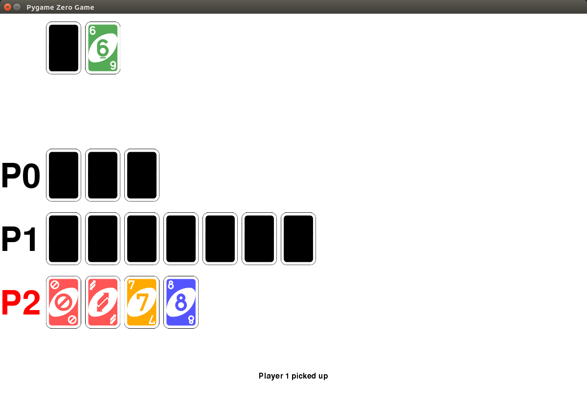

# Uno

A Python implementation of the card game [Uno](https://en.wikipedia.org/wiki/Uno_(card_game))

## Rules

https://en.wikipedia.org/wiki/Uno_(card_game)#Official_rules

## Library usage

An example auto-generated game of 5 players:

```python
from uno import UnoGame
from uno.constants import COLORS
import random

game = UnoGame(5)

while game.is_active:
    player = game.current_player
    player_id = player.player_id
    if player.can_play(game.current_card):
        for i, card in enumerate(player.hand):
            if game.current_card.playable(card):
                if card.color == 'black':
                    new_color = random.choice(COLORS)
                else:
                    new_color = None
                print("Player {} played {}".format(player, card))
                game.play(player=player_id, card=i, new_color=new_color)
                break
    else:
        print("Player {} picked up".format(player))
        game.play(player=player_id, card=None)
```

See [random_game.py](random_game.py)

## CLI

A simple interactive CLI version of the game can be played using keyboard inputs. Just run `uno --players 4` with the desired number of players.

You will be assigned a player number at random, and will be asked to make your move when it is your turn. Enter the number of the card you want to play (shown in your hand), or `p` to pick up. If you play a black card, you will be prompted to choose a colour by number.

## Graphical game

A graphical version of the game can be played, developed using [pygame-zero](http://pygame-zero.readthedocs.io/).



Run the game with:

```bash
pgzrun uno_pgz.py
```
